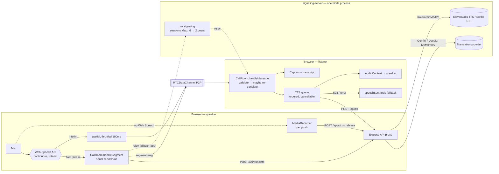

# Talktual Phase 1 — Engineering Audit

**Scope:** the existing Talktual app only (no Talktual 2.0 work).
**Baseline commit:** `34a8400` on branch `claude/kind-archimedes-n6y11p`. The working tree was clean before any edits.
**Audit date:** 2026-11-21. **Environment:** Linux container, Node 22.23.5, npm 10.9.9, headless Chromium 157 (Playwright).

Related reports: [DEFECT_REGISTER](DEFECT_REGISTER.md) · [REPAIR_LOG](REPAIR_LOG.md) · [TEST_REPORT](TEST_REPORT.md) · [SECURITY_REPORT](SECURITY_REPORT.md) · [PERFORMANCE_REPORT](PERFORMANCE_REPORT.md) · [COMPATIBILITY_REPORT](COMPATIBILITY_REPORT.md) · [STABILIZATION_REPORT](STABILIZATION_REPORT.md)

---

## 1. Repository reconnaissance

| Area | Finding |
| --- | --- |
| Layout | Root = React 19 + Vite 6 + Tailwind 4 SPA (`src/`, ~2,000 LOC). `signaling-server/` = one CommonJS file (`server.js`, 467 LOC at baseline): Express 5 + `ws` 8 + `multer` 2. |
| Git | 20 commits. History shows a move from socket.io → raw WebSocket signaling, from LibreTranslate → MyMemory/Gemini/DeepL, and from browser-side ElevenLabs calls → a server proxy (see SEC-08). |
| Build / run | `npm run dev`, `npm run build`, `npm run lint` (= `tsc --noEmit`). Server: `npm start`. Deploy assumptions: Vercel (`vercel.json`, SPA rewrite) for the frontend, Render-style Node service for the server. |
| Tests at baseline | **None.** The server's `test` script was the npm placeholder (`exit 1`). No CI config. |
| Env / config | `.env.example` documents frontend `VITE_*` and backend keys. `.gitignore` excludes `.env*`. No `.env` file is or ever was committed (checked full history). |
| Feature flags | None. Behaviour switches on which provider keys are present (`/api/capabilities`). |
| Dead code | `src/SocketContext.tsx` (socket.io client, never imported); `createLevelMeter` in `audio.ts` (exported, unused — left in place, harmless). |
| Unused deps (root) | `@google/genai`, `express`, `dotenv`, `socket.io`, `socket.io-client`, `@types/express`, `tsx`, `esbuild`, `autoprefixer`, `@types/qrcode.react` — verified with grep and a successful build after removal. |
| Vulnerable deps | Root: 11 advisories (1 critical, 8 high) — mostly via unused `express`/`socket.io` and `vite`. Server: 4 (1 critical `proxy-addr`, `multer` high, direct). All resolved; see SEC-07. |

### Baseline results (before any change)

| Check | Command | Result |
| --- | --- | --- |
| Install (root) | `npm ci` | ✅ 5.5 s |
| Install (server) | `cd signaling-server && npm ci` | ✅ |
| Type-check | `npm run lint` | ✅ 0 errors |
| Build | `npm run build` | ✅ JS 570.89 kB (195.45 kB gzip), CSS 30.86 kB; Vite >500 kB chunk warning |
| Tests | — | ❌ none exist |
| `npm audit` | root / server | ❌ 11 / 4 advisories |
| Server smoke | `PORT=8787 node server.js`, curl `/health`, `/api/capabilities` | ✅ starts, both 200 |
| Live probes | malformed JSON, non-string text, cross-origin, raw WS frames | ❌ 6 defects reproduced (DEF-S01…S07) |

---

## 2. Architecture map

### Session / signaling path

1. **Lobby.** Host (`StartCall`) generates a 6-char code and joins WS session `CODE_signal`. Joiner (`JoinCall`) scans the QR (`/?join=CODE`) or types it and joins the same lobby. When the 2nd peer arrives the server sends `ready` to both; both close the lobby socket.
2. **Call.** Both open a new socket to session `CODE` (`webrtc.connectCall`). First in = `offerer`. On `ready` the call is immediately usable over the **relay** (server forwards `{type:"app"}` frames); the offerer creates a data channel and sends an SDP offer; ICE candidates are queued until the remote description is set. When the channel opens, transport upgrades to **P2P**.
3. **What actually crosses the wire:** text only — `hello` (language + display name), `partial` (interim captions), `segment` (original + translated text). **No audio is sent peer-to-peer and no media tracks are negotiated.** Audio goes only browser → speech service (STT) and server → browser (TTS).
4. **Teardown.** Leaving closes data channel + socket; the server sends `peer-left` to the other side, which returns home after 1.8 s. Unpaired sessions expire after 10 min; dead sockets are reaped by a 30 s ping.

### Pipeline per utterance

capture (Web Speech, continuous) → segmentation (engine finalizes phrases at pauses, gated by PTT + 450 ms tail) → translation (sender side, into the peer's announced language; receiver re-translates if the target is stale) → transport (data channel or relay) → TTS (server streams ElevenLabs PCM; client schedules chunks on the audio clock; MP3 and `speechSynthesis` fallbacks) → playback (strict FIFO queue; barge-in clears it).

---

## 3. Audit method

* Read every source file (client and server) end to end and traced each flow above.
* Treated the brief's audit targets as hypotheses. A concern became a **defect** only with reproducible evidence: a live probe against the baseline server, a failing test against the baseline module, or (for UI wiring that can't be isolated) an unambiguous code-path trace plus a test that fails when the fix is reverted.
* For each repair: regression test → fix → full suite. Server regression tests could not run against the baseline file (it had no export and listened on import), so server defects were reproduced with live probes on the unmodified server *before* refactoring (outputs recorded in DEFECT_REGISTER). Client regression tests were re-run against the baseline modules: **all 7 defect-tagged tests fail on baseline, all 13 behaviour-preservation tests pass on both** (TEST_REPORT §3).
* Security review: threat model, history secret scan, bundle scan, dependency audit, header/origin/validation checks.
* Performance: same benchmark run against baseline and repaired server processes.
* Browser: two-context Chromium E2E against the production build.

---

## 4. Findings by workstream

Defect details, evidence and status are in [DEFECT_REGISTER](DEFECT_REGISTER.md). Summary:

### 3.1 Frontend and client state
* **DEF-C04** Joining an unknown code spun forever; the lobby socket leaked on Back and could later navigate the user into a call. *Fixed.*
* **DEF-C06** Unvalidated peer messages (a payload-less relay frame threw in an async handler). *Fixed.*
* **DEF-C07** If the signaling socket dropped while P2P was up and then P2P closed, status stayed "connected" and every later turn queued silently. *Fixed.*
* **DEF-C11** No up-front warning when neither Web Speech nor server STT is available. *Fixed.*
* **DEF-C09** Accessibility: focused input was `aria-hidden`, sheets lacked dialog semantics, status changes weren't announced. *Fixed.* Contrast of `--text-3` is 2.52:1 (fails WCAG AA) — *open, visual decision* (OBS-05).
* Verified OK: React escapes all peer-provided text (test with HTML payloads); no `dangerouslySetInnerHTML`; API base derives from one config value; Space-bar PTT ignores text inputs; StrictMode double-mount doesn't leak (lobby socket closed in cleanup).

### 3.2 Audio capture, streaming and playback
* **DEF-C01** Barge-in didn't cancel segments queued behind the playing one (they played anyway, and overlapped new speech). *Fixed.*
* **DEF-C03** Leaving a call while the mic prompt was open left the mic live afterwards. *Fixed.*
* **DEF-C10** One `GainNode` per PCM segment stayed connected for the rest of the call. *Fixed.*
* Verified OK: PCM decode handles odd byte splits across chunks; gapless scheduling; mic acquired once per call and stopped on leave.

### 3.3 Speech recognition
* **DEF-C08** Scribe path: quick tap before mic ready → runaway recording; leaving mid-push uploaded the audio anyway; back-to-back pushes shared a chunk buffer. *Fixed.*
* Verified OK: hold/tail gating, duplicate-final suppression, restart after engine end, permission-denied is fatal.
* **OBS-01 (privacy, decision needed):** Web Speech recognition is *armed for the whole call*, not just while the button is held. In Chrome this streams microphone audio to Google's speech service for the call's duration; results outside the hold are discarded locally. This is a deliberate latency trade-off in the current design, so it was not changed — see SECURITY_REPORT SEC-R1.

### 3.4 Translation
* **DEF-C02 / DEF-S09** Failures were masked: the server returned HTTP 200 with the *source* text, the client cached that as the translation (poisoning later identical phrases), and listeners heard source text read in their own language's voice with no indication. Stalled providers had no timeout, and because outgoing segments are serialized, one stall blocked every later turn. *Fixed* (explicit 502/504, no caching of failures, 8 s/10 s timeouts, "untranslated" marking surfaced to both users, original spoken in its own language's voice).
* Verified OK: same-language passthrough, in-flight dedupe, server cache keyed by language pair + exact text, FIFO-bounded caches (2000 server / 500 client).
* **OBS-02:** DeepL codes are passed as bare ISO-639-1 upper case. `NO` is not a DeepL code (DeepL uses `NB`), and `EN`/`PT` targets are legacy variants. Not verified live (no paid calls); a DeepL rejection falls back to MyMemory. Recorded, not changed.

### 3.5 TTS
* Covered by DEF-C01/C10 and server DEF-S08/S09 (text length cap, upstream timeout, upstream cancelled on client disconnect).
* Verified OK: PCM→MP3 fallback on 4xx, browser-voice fallback on 503, key never echoed to clients, `Cache-Control: no-store`, no audio retained server-side.

### 3.6 WebRTC, signaling and sessions
* **DEF-S01 (P0)** One malformed WebSocket frame crashed the whole server (all calls dropped). *Fixed.*
* **DEF-S02** Frames up to 100 MiB accepted and relayed. **DEF-S03** Joins without a session id paired strangers. **DEF-S04** Double join self-paired / left a ghost seat. **DEF-S05** Any message type relayed (a peer could inject `peer-left`/`expired`). *All fixed.*
* STUN: Google public STUN only; TURN optional via `VITE_TURN_*` (static, therefore public, credentials). **Tested path: localhost only** — P2P came up as "Direct" in Chromium E2E; NAT traversal across real networks is **unverified**. Relay fallback is exercised in unit tests.
* **OBS-03:** No automatic reconnect after a signaling drop (documented limitation; implementing it is a feature, not a repair).

### 3.7 API and backend
* **DEF-S06** Any website could use the proxy (CORS `*`, no origin check, no rate limit). *Mitigated via config* (`ALLOWED_ORIGINS`, `RATE_LIMIT_PER_MINUTE`, `TRUST_PROXY`); defaults kept permissive to avoid breaking the existing deployment — **must be set in production** (SEC-R2).
* **DEF-S07** Express default error page leaked stack traces and absolute paths. **DEF-S08** No type/length validation on paid endpoints. **DEF-S10** Upstream error bodies returned to clients. *Fixed.*
* Structural change: `server.js` now exports `createServer(config)`; `node server.js` behaves as before. This was required to test the server at all and is the only refactor in the change set.

### 3.8–3.11 Security, performance, compatibility, testing
See the dedicated reports.

---

## 5. Data flow and retention (summary)

| Data | Leaves the device to | Retained |
| --- | --- | --- |
| Microphone audio (Web Speech browsers) | Browser vendor's speech service, **continuously during a call** (OBS-01) | Per vendor policy |
| Microphone audio (other browsers) | Talktual server → ElevenLabs Scribe, per push | Not stored by Talktual (memory only, ≤10 MB) |
| Transcript text | Talktual server → translation provider; peer (P2P or relay) | Server: in-memory translation cache, ≤2000 entries, no TTL, cleared on restart. Client: ≤500 entries per tab |
| Translated text | Talktual server → ElevenLabs TTS; peer | Not stored |
| Display name, language | Peer only | Not stored |
| IP addresses | Signaling server; peer and STUN server (WebRTC ICE) | Server logs no IPs; no session ids logged after Phase 1 |

Server logs record provider, language pair, latency and byte counts — never utterance text (asserted in tests).
