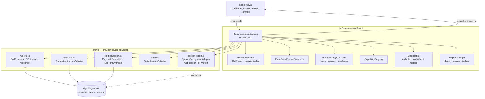

# Talktual 2.0 — Phase 2 Architecture (Communication Engine)

Status: design approved for implementation within the Phase 2 spec · Foundation: `main` @ `89ef81a` (Phase 1 merged)

## 1. Starting point (repository evidence)

Phase 1 left a working, tested app (75 client + 37 server tests, 13-step E2E). Its structural weakness, relevant to every Phase 2 goal, is that **`CallRoom.tsx` (≈800 lines) *is* the engine**: it owns the transport, the recognizer lifecycle, the serialized translate-and-send chain, inbound handling, the TTS queue hooks, status, notices and capability logic, all in React refs and effects. Consequences:

* the call's state is spread across ~20 `useState`/`useRef` values with no explicit lifecycle or legal-transition rules;
* the pipeline can only be tested through a rendered component with every module mocked;
* any Talktual 2.0 UI would have to copy that logic.

The lower layers are sound and already tested (Phase 1): `lib/webrtc.ts` (transport), `lib/speechToText.ts` (Web Speech + server STT), `lib/translate.ts`, `lib/textToSpeech.ts` (ordered, cancellable playback), `lib/audio.ts` (mic + AudioContext), and the server. **They are kept and strengthened in place, not rewritten.** The new code is an engine layer *between* them and the UI.

Measured baseline (M2.0, emulated, stub provider, Chromium): finalized phrase → listener speech start p50 15 ms / p95 19–28 ms; idle connected call → **speech recognizer running with no press and no consent** (P1 reproduced).

## 2. Component boundaries

| Module (spec §4 name) | File | Responsibility |
| --- | --- | --- |
| CommunicationSession / SessionController | `engine/CommunicationSession.ts` | Owns one call: wires adapters, runs the state machines, enforces privacy gates, exposes `getSnapshot()/subscribe()` and commands (`pressTalk`, `releaseTalk`, `setListeningMode`, `grantConsent`, `setLanguage`, `stopListening`, `leave`, …). |
| (state machine) | `engine/sessionMachine.ts` | Pure transition tables + `assertTransition`. |
| AudioCaptureAdapter | `lib/audio.ts` | Mic acquisition/release with epochs (Phase 1), permission state, device-lost events, track gating. |
| AudioTransport / StreamingBuffer | `lib/textToSpeech.ts` (PCM scheduler), `lib/webrtc.ts` (outbox) | Bounded schedule-ahead for PCM; bounded transport outbox. |
| SpeechRecognitionAdapter | `lib/speechToText.ts` | Provider-agnostic interface; `webspeech` and `server-stt` implementations; listening-mode aware; normalized `RecognizedSegment` (text, lang, startedAt, endedAt) and coded errors. |
| TranslationServiceAdapter | `lib/translate.ts` | `translateSegment()` → normalized `TranslationResult` (status, provider, attempts, error code, latency); bounded retry; never reports success for a fallback. |
| SpeechSynthesisAdapter + PlaybackController | `lib/textToSpeech.ts` | Server PCM/MP3 → browser voice fallback; `PlaybackController` with bounded queue, per-segment status events, cancellation. |
| EventBus / SessionEventContract | `engine/events.ts`, `engine/eventBus.ts` | Versioned typed internal events; versioned peer wire messages with validators. |
| CapabilityRegistry | `engine/capabilities.ts` | Browser capabilities + server capabilities → supported features and degradation reasons. Separate from the state machine (spec H). |
| PrivacyPolicyController | `engine/privacy.ts` | Listening modes, consent records (versioned, per processing route), disclosure content, capture gate. |
| Diagnostics | `engine/diagnostics.ts` | Bounded ring buffer of redacted events and latency metrics; opt-in exposure. |
| (segment identity) | `engine/segments.ts` | Segment ids, status lifecycle, bounded dedupe of received ids. |
| UI seam | `engine/useCommunicationSession.ts` | `useSyncExternalStore` hook — the only thing React needs. |

**Not introduced:** ARC or any new provider/router (spec H, §8). Provider selection stays server-side, as today.

## 3. State machines (spec B)

The spec's single list mixes two independent things — whether the *call* is up, and what the *pipeline* is doing. They are modelled as two explicit machines; the snapshot exposes both.

### 3.1 CallPhase (connection lifecycle)

| From → To | Trigger |
| --- | --- |
| `idle → connecting` | `start()` |
| `connecting → waiting-for-peer` | signaling socket joined |
| `waiting-for-peer → connected` | server `ready` |
| `connected → reconnecting` | signaling lost while the call should continue (and P2P not carrying it) |
| `reconnecting → connected` | rejoined with resume token and peer present |
| `reconnecting → waiting-for-peer` | rejoined, peer away |
| `connected → waiting-for-peer` | peer temporarily away (`peer-away`) |
| `* → ended` | user `leave()`, `peer-left`, session `expired` |
| `* → failed` | resume refused, retries exhausted, session full/invalid |

`ended` and `failed` are terminal: commands become no-ops, timers are cleared, adapters disposed exactly once.

### 3.2 Activity (pipeline, per local user)

States: `idle`, `permission-pending`, `ready`, `listening`, `processing`, `paused`, `stopped`, plus *concurrent* counters for outbound `translating` and inbound `synthesizing`/`playing` (these overlap with listening in real conversations, so they are counters/flags in the snapshot rather than exclusive states).

| From → To | Trigger |
| --- | --- |
| `idle → permission-pending` | consent granted, capture requested, browser prompt open |
| `idle/permission-pending → ready` | capture allowed (or no capture needed yet) |
| `ready → listening` | PTT press (push-to-talk) or mode enabled (continuous) |
| `listening → processing` | PTT release (tail + final flush) |
| `processing → ready` | recognizer finalized/stopped |
| `listening → paused` | continuous mode while incoming speech plays (half-duplex, avoids transcribing our own speaker) |
| `paused → listening` | playback finished |
| `* → stopped` | user stop / mic off / permission revoked / device lost |
| `stopped → ready` | user re-enables |

Illegal transitions are rejected and logged to diagnostics (never thrown into the UI).

## 4. Event contracts (spec G)

### 4.1 Internal events — `EngineEvent`, version 1

Every event: `{ v: 1, type, at: number /* ms epoch */, ...payload }`.

| type | payload |
| --- | --- |
| `session.phase` | `from`, `to`, `reason?` |
| `session.activity` | `from`, `to`, `reason?` |
| `transport.changed` | `transport: 'p2p' \| 'relay' \| 'none'` |
| `privacy.changed` | `mode`, `consent: { route, granted, version }`, `capturing: boolean` |
| `permission.changed` | `state: 'unknown' \| 'prompt' \| 'granted' \| 'denied'` |
| `transcript.partial` | `speaker: 'local' \| 'peer'`, `text`, `lang` |
| `transcript.final` | `segment: SegmentRecord` |
| `translation.updated` | `segmentId`, `status`, `text?`, `provider?`, `error?` |
| `playback.status` | `segmentId`, `status: queued\|started\|ended\|cancelled\|failed\|dropped`, `engine?` |
| `interruption` | `kind: 'barge-in' \| 'stop' \| 'leave'`, `cancelledSegments` |
| `recovery` | `kind: 'reconnecting' \| 'reconnected' \| 'gave-up'`, `attempt` |
| `error` | `code`, `fatal`, `message` (user-safe, no payload text) |

Text-bearing events (`transcript.*`, `translation.updated`) go to subscribers (the UI needs them) but are **never written to diagnostics**.

### 4.2 Peer wire protocol — version 1

Unchanged shapes from Phase 1 (`hello`, `partial`, `segment`) plus an optional `v: 1`. Messages without `v` are treated as v1 (Phase 1 peers); unknown `v` is rejected. Segments carry `id` (UUID, the segment's identity end-to-end), `seq` (per-sender, monotonic; new, optional) and the Phase 1 `untranslated` flag. Receivers dedupe by `id` (bounded LRU), so a segment resent after reconnect is never spoken twice.

### 4.3 Signaling protocol additions (server)

| Message | Direction | Purpose |
| --- | --- | --- |
| `{type:"joined", role, resumeToken}` | server → client | sent with `role`; token is 128-bit random, per seat |
| `{type:"join", sessionId, resumeToken}` | client → server | reclaim a seat after a drop |
| `{type:"leave"}` | client → server | intentional leave → immediate `peer-left` |
| `{type:"peer-away"}` / `{type:"peer-back"}` | server → client | peer's socket dropped / reclaimed within grace |
| `ready` with `resumed: true` | server → both | renegotiate P2P after a rejoin |

An unexpected socket close no longer frees the seat immediately: it is held for `RESUME_GRACE_MS` (default 20 s), reclaimable only with the token. Phase 1 clients (no `leave`) therefore see a 20 s delay before `peer-left` on the *other* side; documented.

## 5. Privacy and listening modes (spec J, condition P1)

| | Push-to-talk (default) | Continuous (opt-in) |
| --- | --- | --- |
| Recognizer running | **only while held** + 450 ms tail, then stopped | while the mode is on and the call is connected; paused during incoming playback |
| Results used | yes (all of them — nothing captured is discarded unused) | yes, auto-sent at phrase boundaries |
| Microphone | acquired on first press after consent; tracks enabled only while held | acquired when enabled |
| Indicator | "On air" on the button while held | persistent "Listening continuously" banner + button state; one tap stops |
| Start condition | consent for the processing route **and** user press | consent **and** explicit mode switch |

**Consent gate:** before the first capture on a device, a disclosure sheet states where audio goes for the active route — *browser speech service* (Web Speech: e.g. Google for Chrome, Apple for Safari) or *Talktual server → ElevenLabs* — and that translations go to the configured translation provider. No `getUserMedia` and no `SpeechRecognition.start()` happen before consent. Consent is stored per route with a version; changing the disclosure text bumps the version and re-asks. Declining keeps the call usable for listening.

**Stop guarantees:** `stopListening()` / mic-off / leave / permission revoked / device lost → recognizer `abort()`, recorder stopped without upload, mic tracks stopped, pending uploads' results discarded, state `stopped`. Verified by tests that observe the fake recognizer and media tracks.

**Latency trade-off (documented):** Phase 1 pre-armed the recognizer to save ~200–500 ms of engine start on the first word. Push-to-talk now starts on press; the tail-flush is unchanged. Real start-up cost is unmeasured in this environment (fake recognizer) and must be checked on devices.

## 6. Failure recovery (spec I)

| Failure | Behaviour |
| --- | --- |
| Signaling socket lost, P2P up | Call continues on P2P; transport reconnects signaling in background |
| Signaling socket lost, P2P down | `reconnecting`; exponential backoff 0.5→8 s, ≤6 attempts / ~30 s; rejoin with token; renegotiate P2P |
| Rejoin refused (grace expired) | `failed` with "The call ended while you were offline" |
| Outbound segments during reconnect | held in a bounded outbox (≤20 segments; partials dropped); resent with the same ids; peer dedupes |
| Provider timeout / error / 429 | Translation `failed` with code; one retry for fast `network` failures only (a timeout already spent the full 10 s budget and turns are serialized); then untranslated path (Phase 1) |
| TTS failure | browser voice fallback (`playback.status engine: browser`); if that fails, `failed` — text still shown |
| Permission denied | `stopped` + notice; listening to the peer continues; retry button |
| Device removed (track ended) | `stopped` + notice; next press re-acquires |
| Unsupported capability | CapabilityRegistry reason → UI notice; PTT disabled only for the missing capability |
| Malformed peer/server event | dropped, diagnostics counter incremented |
| User stop / leave during any stage | in-flight translate/TTS aborted, queued playback cancelled, no late result is spoken or sent |

## 7. Bounded resources (spec C)

| Buffer | Bound |
| --- | --- |
| Playback queue | 12 segments; overflow drops the oldest *not yet started* (`playback.status dropped`) |
| PCM schedule-ahead | ≤ 10 s ahead of the audio clock; reader paused (backpressure) beyond that |
| Transport outbox | 20 segments + latest hello; partials not queued |
| Server-STT recording | auto-release at 60 s |
| Received-id dedupe | 500 ids (LRU) |
| Transcript (UI) | 500 most recent segments |
| Diagnostics ring | 300 events |
| Caches | 500 client / 2000 server (Phase 1) |

## 8. Observability (spec L)

`Diagnostics` records phase/activity transitions, segment timings (final → translated → sent; received → playback start), retries, failures (codes only), cancellations, provider/engine used, queue depths and drops. **Redaction is by allowlist**: only numeric, boolean, id and enum fields are kept; any other key is dropped. No raw audio, transcript text, translation text, display names or secrets. Exposed via `session.getDiagnostics()`; in the browser only when `?debug=1` (or `localStorage.talktualDebug = "1"`) as `window.__talktualDiagnostics()`.

## 9. Compatibility of the change

* UI stays visually the same; additions are the consent sheet, a listening-mode control, the continuous-listening banner and a "Reconnecting…" status.
* Mixed versions: Phase 1 ↔ Phase 2 peers interoperate (wire v1 is a superset). Phase 1 client ↔ Phase 2 server works (no token → no resume, unexpected close held 20 s). Phase 2 client ↔ Phase 1 server: no `joined`/token → reconnect disabled, everything else works.
